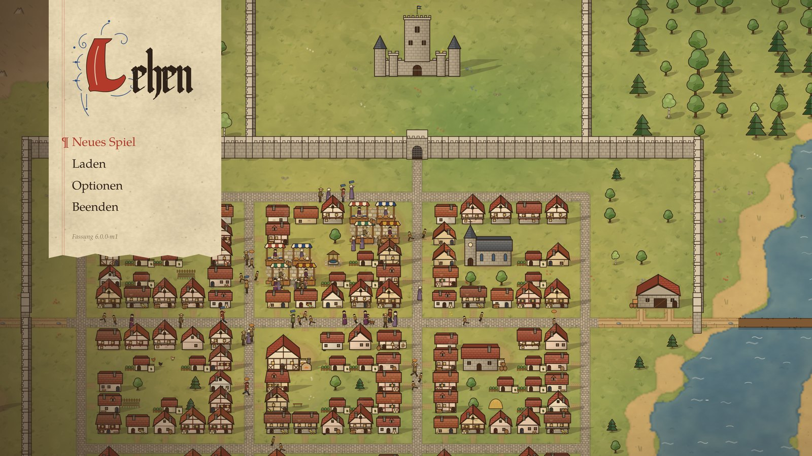
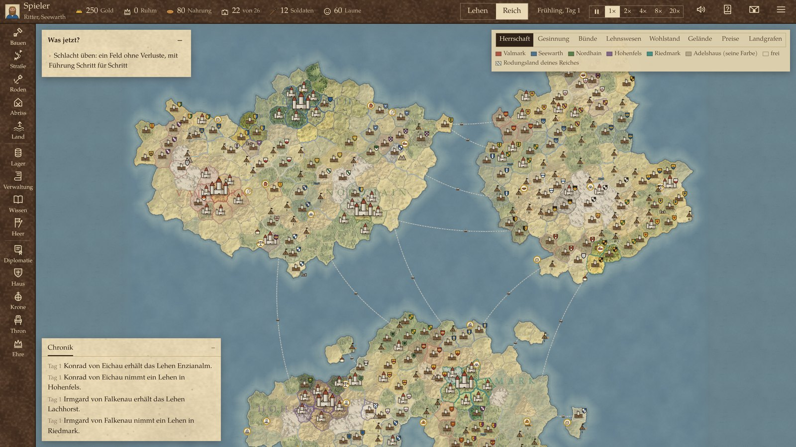
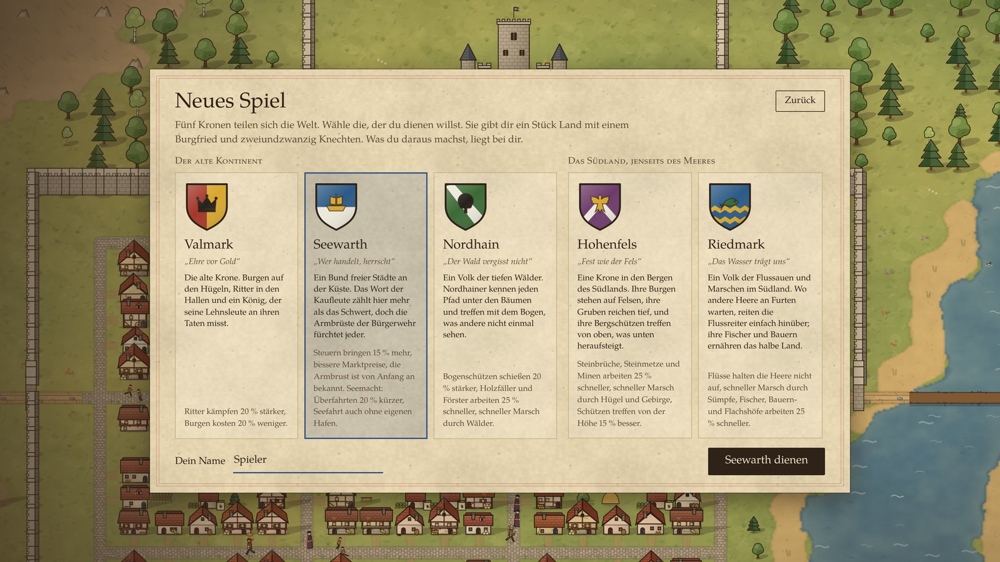
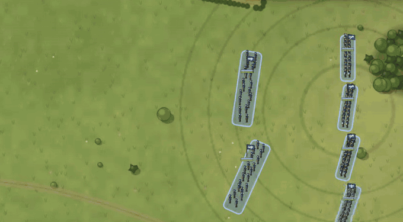

# Lehen

A medieval strategy game about building towns, ruling a kingdom and going to war, all in one world.

You start with a wooden keep, twenty-two peasants and a patch of forest. What you make of it is up to you. Lay out your own town and raise it building by building, or hand it to a steward and rule from a distance.

**Status:** in development. German only for now, no release date yet.

## The world

Five crowns divide the map between them, spread over three landmasses and a scatter of islands. A new world has around 400 provinces. Rival lords and crowns found towns, sign treaties, trade and start wars whether you take part or not.

## Your kingdom

Each crown plays differently. Valmark has stronger knights, Seewarth richer merchants and faster crossings, Nordhain better archers. Hohenfels digs deep into the mountains, and Riedmark crosses rivers that stop other armies.

## War

Battles run in real time and take minutes, not hours. Choose a formation, place your regiments and use the ground. Flanks, morale and terrain all count. If you would rather watch, your commander takes over.

## What else is in it

- Roads you draw by hand, with carts hauling goods between storehouses
- Markets, caravans and sea routes
- Noble houses with their own coats of arms
- Treaties, alliances and feuds
- Provinces with their own prosperity and unrest
- Sieges, walls and fights inside the town itself
- Research, faith and seafaring
- Pause and speed up the game from 1× to 20×

## How it is made

- **Art:** every building, figure, coat of arms and map is drawn in code on HTML Canvas, with no image assets.
- **Sound:** music and effects are synthesized at runtime with the Web Audio API.
- **Simulation:** the world runs in its own Node.js process, separate from the interface.
- **Dependencies:** no npm packages. WebSocket and MySQL support for the server version are written from scratch.
- **Desktop:** a standalone Electron build is in progress.
- **Tests:** 387 automated tests.

The source code is not public. This repository is the project page.

## Credits

Typeface: TeX Gyre Pagella, GUST Font License.

© 2026. All rights reserved.
